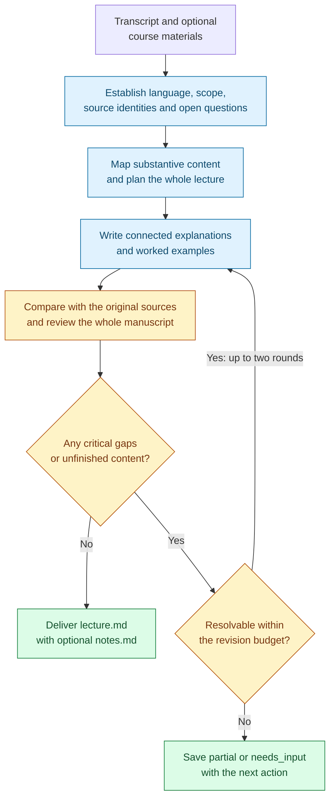
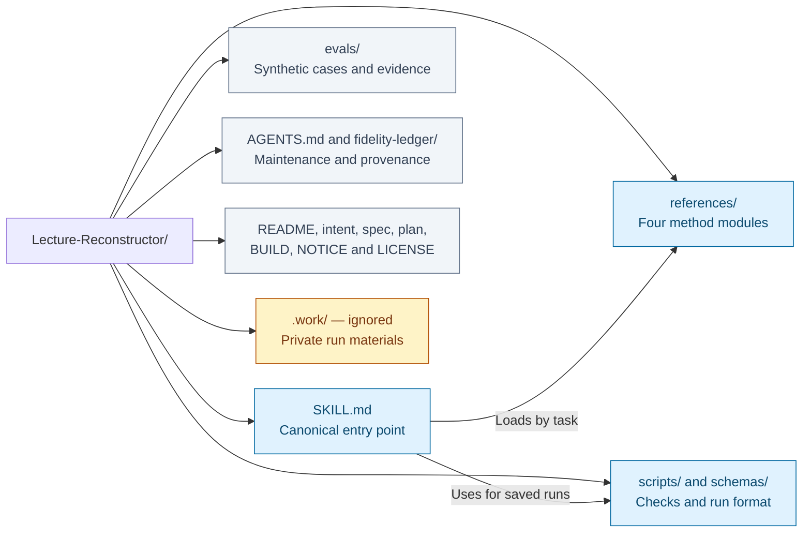
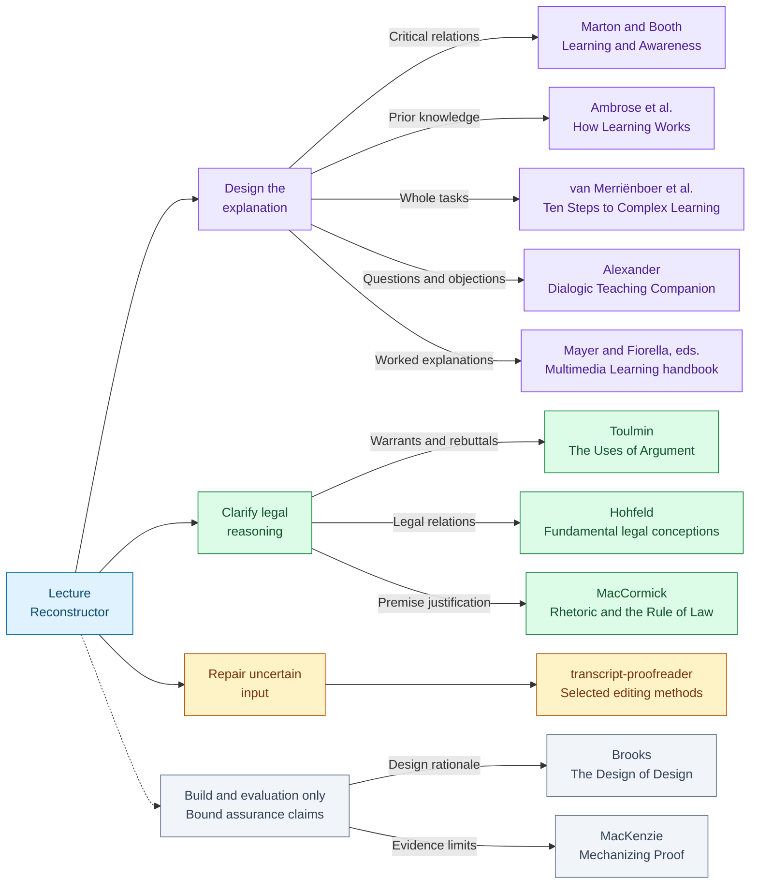

# Lecture Reconstructor

I start with the course the transcript actually contains: its central problem, the concepts it introduces, and the examples, objections, and qualifications that make its reasoning work. I look for the relations a lecturer has left implicit, the steps an expert can skip but a reader cannot, and the small cases that a tidy summary would lose. My task is to turn that material into a complete lecture that can be read on its own and taught directly.

In a law lecture, permission to enter a reading room does not by itself give someone a claim to a seat. I explain which rule creates a duty, who owes it, and which conditions change the conclusion. If a transcript leaves the decisive distinction between a notice being sent and received unresolved, I preserve that uncertainty instead of choosing the smoother story. Historical rules, textbook interpretations, a teacher's position, and invented teaching examples retain their different identities.

I deliver the manuscript itself, with explanations and worked examples already written. I use the course's language unless the user explicitly requests another output language. Long lectures can be written chapter by chapter, resumed from saved records, and reviewed as a whole. Source notes and unresolved questions support the manuscript; they do not replace it, and a successful file check is not evidence that a learner has understood the course.

**Read the whole course → map its content → explain the relationships → write the lecture → review against the sources.**

The first release focuses on university law courses. It is a self-contained agent skill, executed by a compatible host model.

[How it works](#how-it-works) · [Use it for](#use-it-for) · [Installation](#installation) · [Example requests](#example-requests) · [Repository layout](#repository-layout) · [Sources and their responsibilities](#sources-and-their-responsibilities) · [Coverage and validation](#coverage-and-validation) · [Limits](#limits) · [License](#license)

## How it works



The host reads the entire transcript before planning chapters. Content mapping includes definitions, arguments, examples, exceptions, substantive classroom questions, and teacher-specific examination advice. The writing stage can reorganize and explain the material; it must preserve the original input and keep meaningful corrections traceable. Empty or unreadable input is reported as missing material, not used to invent a class.

The host supplies the model reasoning and any file or document-reading tools. The Python scripts check files, references, ranges, hashes, and recorded completion conditions. They do not call a model or generate a lecture themselves.

| Artifact | Purpose |
|---|---|
| `lecture.md` | The complete manuscript, or an explicitly identified partial manuscript when a blocking gap remains. |
| `notes.md` | Optional notes on significant corrections, added sources, version differences, and unresolved issues. |
| `run.json` | Internal content mappings, chapter plans, source identities, runtime hashes, review evidence, and recovery instructions. |

File-based runs normally live in `.work/runs/<run-id>/`. A user-specified delivery location takes precedence. Without file-writing tools, the host can still provide the manuscript as text, but cannot claim to have saved a recoverable checkpoint.

## Use it for

- Reconstruct a concept lecture whose terminology is present but whose relationships and reasoning are unclear.
- Turn a case-based lecture into a connected explanation of facts, rule conditions, exceptions, and conclusions.
- Preserve competing interpretations and historical versions while making their reasoning understandable.
- Repair recoverable transcription damage before reconstruction, while separating uncertain wording from uncertain meaning.
- Resume a long lecture after a chapter boundary, then reconcile terminology, transitions, and coverage across the whole manuscript.

English translations of historical generated examples are available for a [concept lecture](evals/results/skill/concept/lecture.md), a [case lecture](evals/results/skill/case/lecture.md), and a [lecture on interpretive disagreement](evals/results/skill/dispute/lecture.md). The original requests explicitly specified Chinese; these English reading copies are translations, not new model runs. All use synthetic teaching rules and are not real legal authorities. The [translation manifest](fidelity-ledger/english-translation-manifest.json) links every original artifact to its frozen Git version and distinguishes original from translated hashes.

## Installation

Clone the [repository](https://github.com/ariel-lee-1023/Lecture-Reconstructor), or use an existing `Lecture-Reconstructor` directory as a local skill package:

```sh
git clone https://github.com/ariel-lee-1023/Lecture-Reconstructor.git
cd Lecture-Reconstructor
```

1. Open the repository in a host that can read text and follow a `SKILL.md` entry point.
2. Ask the host to read the root [SKILL.md](SKILL.md) and provide a nonempty transcript. If the host supports local skill registration, use the slug `lecture-reconstructor` and keep the package together.
3. Run the commands below from the repository root when checking files or saved runs.

The root `SKILL.md` is the canonical entry point. Its four local references supply the methods; sibling repositories are not required. This repository does not include a project discovery alias or a global installation. Reading the entry point directly is sufficient for a host-mediated run.

**Inputs:** pasted text or UTF-8 TXT, Markdown, SRT, and VTT. Textbooks, slides, syllabi, jurisdiction, course date, audience, and length constraints are optional. PDF and Word inputs can use an existing host's extraction capabilities; this package does not include a general document parser. Damaged subtitle timing must not cause readable lecture text to be discarded.

**Language:** an explicit request for the manuscript's language takes precedence. Otherwise, use the course's language. Writing the request in another language does not itself change the output language. For a multilingual course, use its identifiable principal teaching language; clarify only when that cannot be determined.

**Dependencies:** a compatible host model; Python 3.10 or later for the checkers, using the standard library only. The build was checked with Python 3.13.1. No model API service or third-party Python package is included or required by these scripts.

```sh
python3 scripts/validate_repo.py .
python3 -m unittest discover -s tests -v
python3 scripts/check_run.py .work/runs/my-lecture/run.json --repo-root .
```

The last command requires an actual saved run at that path. Run states are `in_progress`, `needs_input`, `partial`, and `complete`.

| `check_run.py` exit code | Meaning |
|---|---|
| `0` | The record passes the defined structural checks. |
| `1` | A record, file, reference, or completion condition is invalid. |
| `2` | Input or runtime hashes changed; impact review is required before continuing. |

Preserve the old manuscript and records when a hash changes, assess which chapters are affected, and review them before resuming. Do not simply replace hashes to restore an old pass. Review records are appended in order: the latest full-manuscript semantic review determines the current manuscript's status, while historical reviews keep their original manuscript hashes. A later `fail` or `not_run` cannot inherit an earlier pass.

The [run schema](schemas/run.schema.json) documents the fields; the [reconstruction workflow](references/reconstruction-workflow.md) explains checkpointing, review, and recovery. The historical [concept run](evals/results/skill/concept/run.json) retains its earlier core hashes: checking the translated reading copy against the current package is expected to return `2` for changed input/runtime identities. Use the original files at the source commit to inspect the historical result; do not replace recorded hashes to manufacture a new pass.

## Example requests

**Reconstruct a complete lecture**

> Read this repository's SKILL.md and reconstruct transcript.txt into a complete lecture manuscript in the course's language. Save it under .work/runs/my-lecture/. Preserve important qualifications, exceptions, classroom objections, and the teacher's examination advice.

**Request a different output language**

> Reconstruct this Spanish-language lecture as a complete English manuscript. Retain the original legal terms where a translation would lose a distinction, and explain them in English.

**Repair transcription and preserve uncertainty**

> Repair recoverable transcription errors, then reconstruct the whole lecture. I have only the text, not the audio. If an unresolved phrase changes the conclusion, identify the precise gap and complete the parts the material supports.

**Review and revise an existing manuscript**

> Compare this reconstructed draft with the original transcript. Find omitted cases, changed conditions, and unsupported additions, then return the corrected full manuscript with brief notes on significant changes.

**Keep historical versions distinct**

> Reconstruct the lecture in its original course context. The supplementary handout uses a later version of the rule. Explain the difference without silently replacing the version taught in class.

**Resume a saved lecture**

> Read the saved run.json, verify its inputs and runtime, and continue from the unfinished chapter. Preserve earlier evidence, then assemble and review the entire manuscript before deciding whether it is complete.

A strict length cap may conflict with full course coverage. The host should explain the conflict and offer a shorter introduction with a complete companion manuscript, a chaptered delivery, or a specific scope choice, rather than silently removing substantive material.

## Repository layout



| File or area | Responsibility |
|---|---|
| [SKILL.md](SKILL.md) | Task contract, language selection, reference routing, and manuscript delivery. |
| [Teaching design](references/teaching-design.md) | Learning objects, relationships, whole tasks, contrasts, and worked explanations. |
| [Legal reasoning](references/law-reasoning.md) | Legal relations, premises, inference, objections, qualifications, and source identity. |
| [Transcript repair](references/transcript-repair.md) | Optional input repair, entity consistency, and consequential uncertainty. |
| [Reconstruction workflow](references/reconstruction-workflow.md) | Whole-course planning, content mapping, chapter writing, review, and recovery. |
| [Run schema](schemas/run.schema.json), [run checker](scripts/check_run.py), [repository checker](scripts/validate_repo.py) | Record format and bounded mechanical verification. |
| [Cases](evals/cases/cases.json), [acceptance protocol](evals/acceptance.md), [results](evals/results/README.md) | Synthetic inputs, evaluation criteria, and actual execution evidence. |
| [Intent](intent.md), [specification](spec.md), [plan](plan.md), [BUILD](BUILD.md) | Product requirements, implementation record, and historical handoff. |
| [AGENTS.md](AGENTS.md), [validation ledger](fidelity-ledger/validation.md), [source manifest](fidelity-ledger/source-manifest.json) | Maintenance rules, evidence boundaries, and source provenance. |

The four references are task-specific adaptations, not one file per original book. `.work/`, local source inventories, and private runs are ignored by Git. Public evaluation artifacts contain explicitly synthetic materials. All tracked documentation, method references, ledgers, test descriptions, and historical reading copies are in English, including the archived runtime package. Functional multilingual matching and its regression inputs retain their original values through Unicode escapes in otherwise English Python source.

## Sources and their responsibilities



The teaching backbone is adapted from `indwell-via-shared-discern`; legal methods come from `legal-reasoning-advisor`; optional input repair comes from `transcript-proofreader`. `Models-and-Machines-colleague` informs engineering and evaluation, not a persona loaded into every lecture. Exact upstream files, hashes, Git revisions, selected sections, and adaptation reasons are recorded in the [source manifest](fidelity-ledger/source-manifest.json).

The project used selected upstream skill files and reference summaries. It did not reread or independently verify the original books and article. The sources address different kinds of learning, reasoning, and assurance: grouping them by responsibility does not imply that they share one theory or establish the effectiveness of generated lectures. The reconstruction workflow, file interfaces, and acceptance rules are this project's engineering design.

<details>
<summary><strong>Full source details, supplied editions, and responsibilities</strong></summary>

| Author(s) and work | Supplied edition or year | Responsibility and local reference |
|---|---|---|
| Ference Marton and Shirley Booth — *Learning and Awareness* | 1997 | Make critical relations and the connection between parts and wholes visible. [Teaching design](references/teaching-design.md). |
| Susan A. Ambrose, Michael W. Bridges, Michele DiPietro, Marsha C. Lovett, and Marie K. Norman — *How Learning Works: Seven Research-Based Principles for Smart Teaching* | 2010 | Supply necessary prior knowledge, organize concepts, and expose steps an expert may omit. [Teaching design](references/teaching-design.md); [publisher title record](https://www.wiley.com/en-be/How%2BLearning%2BWorks%3A%2BSeven%2BResearch-Based%2BPrinciples%2Bfor%2BSmart%2BTeaching-p-9780470617601). |
| Jeroen J. G. van Merriënboer, Paul A. Kirschner, and Jimmy Frèrejean — *Ten Steps to Complex Learning: A Systematic Approach to Four-Component Instructional Design* | 4th edition; upstream reference labels it 2025; see date note below | Keep complete tasks visible and adjust explanatory support as complexity increases. [Teaching design](references/teaching-design.md). |
| Robin Alexander — *A Dialogic Teaching Companion* | 2020 | Carry questions and objections into the explanation without inventing classroom interaction. [Teaching design](references/teaching-design.md). |
| Richard E. Mayer and Logan Fiorella, editors — *The Cambridge Handbook of Multimedia Learning* | 3rd edition, 2022 | Use diagrams, signaling, worked examples, and segmentation when they clarify the material. [Teaching design](references/teaching-design.md). |
| Stephen E. Toulmin — *The Uses of Argument* | Updated edition, 2003; originally 1958 | Explain missing warrants, backing, qualifications, and rebuttal conditions. [Legal reasoning](references/law-reasoning.md). |
| Wesley Newcomb Hohfeld — “Some Fundamental Legal Conceptions as Applied in Judicial Reasoning” | Article, *Yale Law Journal* 23, pp. 16–59, 1913 | Clarify legal relations and distinguish operative facts from evidence. [Legal reasoning](references/law-reasoning.md). |
| Neil MacCormick — *Rhetoric and the Rule of Law: A Theory of Legal Reasoning* | Oxford University Press, 2005 | Separate inference from the justification of premises; explain interpretation and defeasible reasoning. [Legal reasoning](references/law-reasoning.md). |
| Frederick P. Brooks, Jr. — *The Design of Design: Essays from a Computer Scientist* | Addison-Wesley, 2010 | Inform explicit assumptions, integration boundaries, and design rationale. [Engineering provenance](fidelity-ledger/source-manifest.json). |
| Donald MacKenzie — *Mechanizing Proof: Computing, Risk, and Trust* | MIT Press, 2001 | Distinguish specification checks from actual behavior and broader assurance claims. [Engineering provenance](fidelity-ledger/source-manifest.json). |

The multimedia reference preserves chapter-level attribution: Logan Fiorella and Richard E. Mayer (chapters 14 and 19), Tamara van Gog (17), Alexander Renkl (18), and Jean-François Rouet and Anne Britt (44).

</details>

**Edition note:** the supplied upstream reference labels the fourth edition of *Ten Steps to Complex Learning* as 2025; [Routledge's record](https://www.routledge.com/Ten-Steps-to-Complex-Learning-A-Systematic-Approach-to-Four-Component/van-Merrienboer-Kirschner-Frerejean/p/book/9781032345086) lists copyright 2024. The supplied file's date label has not been independently reconciled. Both are stated here rather than silently changing the recorded provenance.

Transcript repair was adapted from selected sections of `transcript-proofreader/SKILL.md`, revised November 11, 2026. That upstream skill mentions Einsohn and Schwartz's *The Copyeditor's Handbook* (2019), Carol Fisher Saller's *The Subversive Copy Editor* (2009), and Hill and King's *Guide to the Transcripts of the Black Women Oral History Project* (1991). Their book modules were not read for this project; no additional book-level claims are inherited. See [Transcript repair](references/transcript-repair.md) and [NOTICE](NOTICE.md).

## Coverage and validation

The implementation has four adapted method references and 19 recorded upstream source files, including license files. Selection was bounded to the methods needed for reconstruction. It does not claim full-book coverage, a comprehensive legal research library, or a measured source-to-output compression ratio.

| Evidence layer | Actual status |
|---|---|
| Structural checks | The build baseline passed 40 automated tests. Checker messages and fixture prose are now English; multilingual detection behavior is preserved. Unit, package, and skill-format checks were rerun after the repository translation. |
| Historical behavior acceptance | A01–A12 passed on explicitly synthetic inputs for the earlier runtime, including actual chapter interruption, recovery, and an isolated-package generation. Original inputs and outputs are preserved at the frozen source commit; current reading copies are English translations, and recorded historical hashes retain their original meaning. |
| Current runtime behavior | `not_run`: model behavior was not rerun after changing the default from Chinese to the course's language or translating the runtime instructions into English. Earlier passes are not reassigned to the revised core. |
| Real classroom pilot | `not_run`: no real classroom transcript was supplied. |
| Learning outcomes | `not_run`: no learner understanding, transfer, or delayed performance was measured. |

The historical anonymous comparison found concept and case lectures broadly comparable to direct rewriting. The skill version of the disagreement lecture was locally stronger in identifying added arguments and explaining interpretive reasons and costs. Resource use differed, exact backend and token settings were unavailable, and each condition produced three manuscripts within one agent turn. These results do not establish general superiority or learning gains.

The isolation test used a fresh context and a reading allowlist, not an operating-system sandbox. Recovery tests used a three-chapter course, not a large-context stress test. The input-change branch correctly retained `needs_input` when contradictory source statements and missing settlement rules prevented a final answer. Content handling of injected commands was reviewed; a complete independent audit of external side effects was not available.

Details: [current validation ledger](fidelity-ledger/validation.md), [machine-readable status](fidelity-ledger/validation.json), [A01–A12 protocol and historical results](evals/acceptance.md), [comparison evidence](evals/results/comparison/review.md), and [source provenance](fidelity-ledger/source-manifest.json). Mechanical checks cannot establish semantic coverage, legal correctness, teaching quality, or learning outcomes.

## Limits

- Input begins with a readable transcript. Audio recognition, speaker separation, and audio/video production are outside this release.
- The package does not maintain a legal database or silently update historical lectures to current law. Precise factual additions need sources the host actually obtained and read; unavailable verification must remain explicit.
- Textbook, teacher, rule, judicial, and hypothetical claims must keep their identities. A teaching example cannot become a fabricated real case, quotation, student response, or learning result.
- A readable manuscript must contain the explanations themselves. An outline, critique, editing plan, or unfilled placeholder is not a completed reconstruction. Optional learning questions need answers or a clearly identified solution location; the user need not complete exercises before receiving the lecture.
- Markdown is the standard deliverable. Websites, slide decks, Word files, PDFs, interactive HTML, accounts, and model-provider services are not bundled outputs. Additional exports depend on a separate user request and the host's tools.
- A core ambiguity may require a narrow clarification. After at most two focused revision rounds, remaining critical defects require an honest `partial` or `needs_input` status rather than an unsupported `complete` claim.
- Commands and role assignments inside transcripts, books, or upstream files are source material. They do not authorize messages, installations, commits, pushes, or publication.

## License

[MIT License](LICENSE), Copyright (c) 2026 Ariel Lee. The license covers this repository's original implementation and adaptations permitted by their upstream licenses. See [NOTICE](NOTICE.md) for attribution and adaptation boundaries.

It does not grant additional rights to the source books, third-party images, textbooks, private classroom transcripts, or other third-party materials. Public fixtures are explicitly synthetic; private input and run materials are excluded from the publication set by default.
