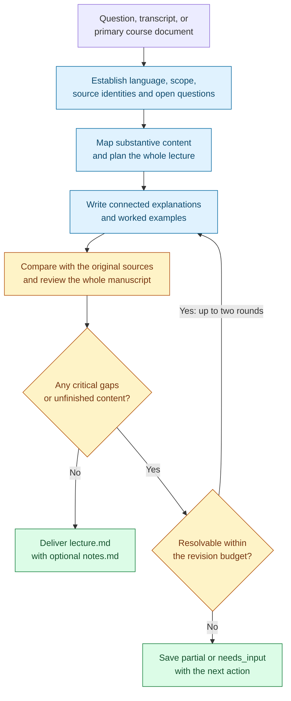
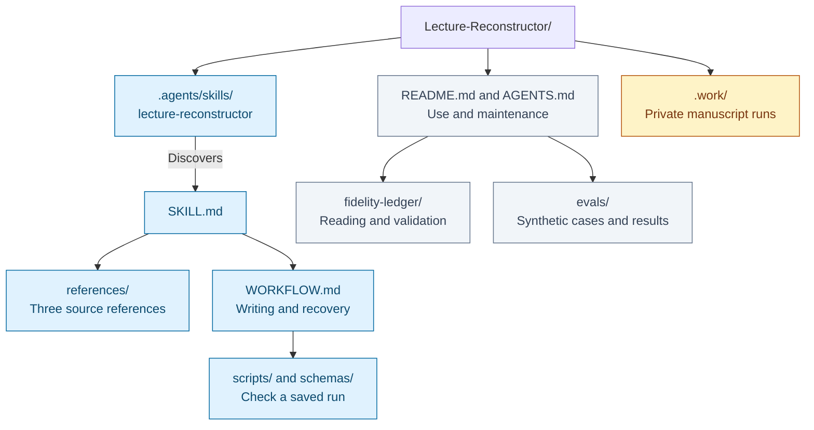
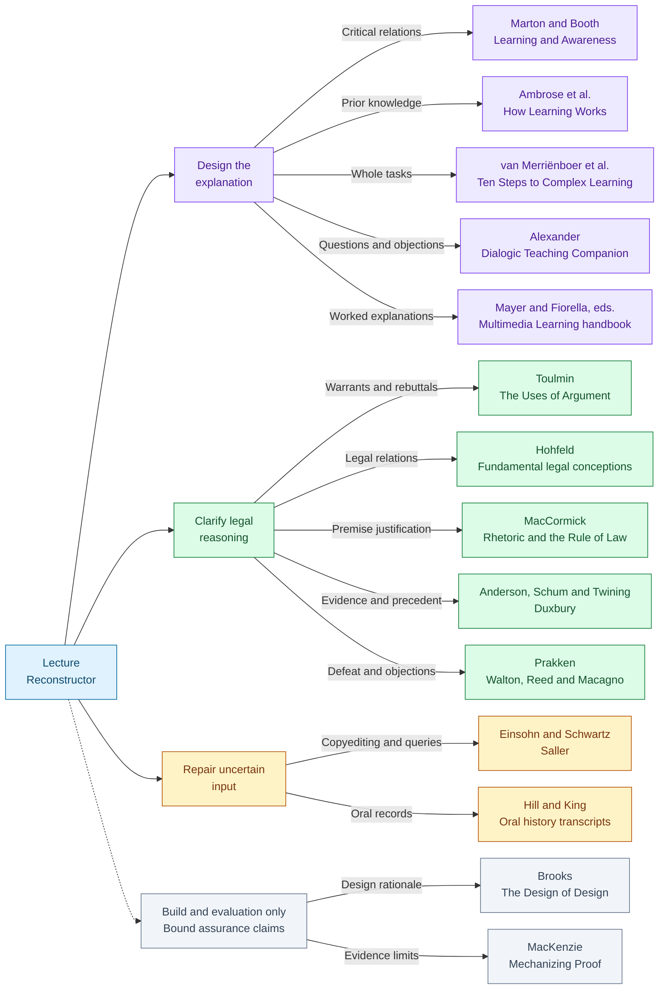

# Lecture Reconstructor

I look for the question that changes what a student can see or decide. A fluent lecture can miss that question for an hour. A badly told example can preserve everything needed to answer it. When the class takes a wrong turn, I keep the useful facts, reconstruct why the answer seemed plausible, and turn to the passage or document that can decide the issue.

Suppose a teacher says that posting a letter on Friday saves the claim. The contract has one dispatch rule for routine correspondence and a receipt deadline for claims. I would begin the lecture with the envelope still in the courier’s hands. What kind of notice is inside? Which clause governs it? Would changing only the delivery date change the answer? The distinction in the contract can support a complete lesson even if the original class contributed little beyond the example.

I write the lecture itself, in the course language unless the user asks for another. Where classroom material survives, I preserve its substantive questions and qualifications. Where the best material is a judgment, contract, literary passage, or dataset, I can redesign the lesson around a close reading of that source and identify the basis for the new account.

**Read the whole course → map its content → explain the relationships → write the lecture → review against the sources.**

The skill reconstructs and designs university lectures, with additional methods for legal analysis and editorial repair. A compatible host model executes the self-contained package.

[How it works](#how-it-works) · [Use it for](#use-it-for) · [Installation](#installation) · [Example requests](#example-requests) · [Repository layout](#repository-layout) · [Sources and their responsibilities](#sources-and-their-responsibilities) · [Coverage and validation](#coverage-and-validation) · [Limits](#limits) · [License](#license)

## How it works



A course export can put an automatic recap above the recorded exchange. The exchange establishes how the speaker corrected a count or answered an objection. A slide may supply the table the lecturer pointed to, while the next slide announces a topic the class deferred. The manuscript identifies the relevant source wherever that distinction affects the lesson.

Before planning chapters, the host reads the class materials in scope and identifies the problem the evidence can actually answer. A weak or absent transcript can be complemented or replaced as the teaching foundation by an accessible primary document. Relevant new reading is chosen to resolve an identifiable issue. Important corrections and newly developed arguments keep their own attribution.

The host supplies the model reasoning and any file or document-reading tools. The Python scripts check files, references, ranges, hashes, and recorded completion conditions. They do not call a model or generate a lecture themselves.

| Artifact | Purpose |
|---|---|
| `lecture.md` | The complete manuscript, or an explicitly identified partial manuscript when a blocking gap remains. |
| `notes.md` | Optional notes on significant corrections, added sources, version differences, and unresolved issues. |
| `run.json` | Internal content mappings, chapter plans, source identities, runtime hashes, review evidence, and recovery instructions. |

File-based runs normally live in `.work/runs/<run-id>/`. A user-specified delivery location takes precedence. Without file-writing tools, the host can still provide the manuscript as text, but cannot claim to have saved a recoverable checkpoint.

## Use it for

- Build a new lecture from the operative text when a class leaves an important problem unanswered.
- Reconstruct a concept lecture whose terminology is present but whose relationships and reasoning are unclear.
- Turn a case-based lecture into a connected explanation of facts, rule conditions, exceptions, and conclusions.
- Preserve competing interpretations and historical versions while making their reasoning understandable.
- Repair recoverable transcription damage before reconstruction, while separating uncertain wording from uncertain meaning.
- Resume a long lecture after a chapter boundary, then reconcile terminology, transitions, and coverage across the whole manuscript.

For examples from the current package, read the [damaged-crate contract lecture](evals/results/source-led/clause/lecture.md), the [close reading of a story](evals/results/source-led/story.md) or the [lecture correcting a comparison of rates](evals/results/source-led/rate.md).

English translations of historical generated examples are available for a [concept lecture](evals/results/skill/concept/lecture.md), a [case lecture](evals/results/skill/case/lecture.md), and a [lecture on interpretive disagreement](evals/results/skill/dispute/lecture.md). The original requests explicitly specified Chinese; these English reading copies are translations, not new model runs. All use synthetic teaching rules and are not real legal authorities. The [translation manifest](fidelity-ledger/english-translation-manifest.json) links every original artifact to its frozen Git version and distinguishes original from translated hashes.

## Installation

Clone the [repository](https://github.com/ariel-lee-1023/Lecture-Reconstructor), or use an existing `Lecture-Reconstructor` directory as a local skill package:

```sh
git clone https://github.com/ariel-lee-1023/Lecture-Reconstructor.git
cd Lecture-Reconstructor
```

1. Open the repository in a compatible host. The project discovery entry `.agents/skills/lecture-reconstructor` points to the repository root through the relative symlink `../..`.
2. Provide a classroom transcript, a concrete question or fact record, or primary material such as a judgment, contract, or passage. A host without project discovery can read the root [SKILL.md](SKILL.md) directly. Keep the package together for its workflow, sources, and checkers.
3. Run the commands below from the repository root when checking files or saved runs.

**Inputs:** Pasted material, UTF-8 TXT, Markdown, SRT and VTT are supported. A capable host can also extract PDF or Word material. For a document-led lesson, a substantive source can be sufficient by itself. Supply the course, period, intended audience, or length if known. Preserve the text of damaged subtitle cues.

**Language:** An explicit manuscript-language request takes precedence. Otherwise use the principal language of the course or, when classroom speech is unavailable, the substantive course materials. The language of the request and the export interface do not set the manuscript language.

**Dependencies:** a compatible host model; Python 3.10 or later for the checkers, using the standard library only. The build was checked with Python 3.13.1. No model API service or third-party Python package is included or required by these scripts.

```sh
python3 scripts/validate_repo.py .
python3 -m unittest discover -s tests -v
python3 scripts/check_run.py .work/runs/my-lecture/run.json --repo-root .
```

The last command requires an actual saved run at that path. Run states are `in_progress`, `needs_input`, `partial`, and `complete`.

| `check_run.py` exit code | Meaning |
|---|---|
| `0` | The record passes the defined structural checks. |
| `1` | A record, file, reference, or completion condition is invalid. |
| `2` | Input or runtime hashes changed; impact review is required before continuing. |

Preserve the old manuscript and records when a hash changes, assess which chapters are affected, and review them before resuming. Do not simply replace hashes to restore an old pass. Review records are appended in order: the latest full-manuscript semantic review determines the current manuscript's status, while historical reviews keep their original manuscript hashes. A later `fail` or `not_run` cannot inherit an earlier pass.

The [run schema](schemas/run.schema.json) documents the fields; the [reconstruction workflow](WORKFLOW.md) explains checkpointing, review, and recovery. The historical [concept run](evals/results/skill/concept/run.json) retains its earlier core hashes: checking the translated reading copy against the current package is expected to return `2` for changed input/runtime identities. Use the original files at the source commit to inspect the historical result; do not replace recorded hashes to manufacture a new pass.

## Example requests

> The seminar says only that the deadline matters. Read the contract, decide which deadlines govern which notices, and use the teacher's mistaken example to build a complete lesson.

> There is no class transcript. Use this story to teach what the narrator can know, and show which sentences allow a second reading.

**Reconstruct a complete lecture**

> Read this repository's SKILL.md and reconstruct transcript.txt into a complete lecture manuscript in the course's language. Save it under .work/runs/my-lecture/. Preserve important qualifications, exceptions, classroom objections, and the teacher's examination advice.

**Request a different output language**

> Reconstruct this Spanish-language lecture as a complete English manuscript. Retain the original legal terms where a translation would lose a distinction, and explain them in English.

**Repair transcription and preserve uncertainty**

> Repair recoverable transcription errors, then reconstruct the whole lecture. I have only the text, not the audio. If an unresolved phrase changes the conclusion, identify the precise gap and complete the parts the material supports.

**Review and revise an existing manuscript**

> Compare this reconstructed draft with the original transcript. Find omitted cases, changed conditions, and unsupported additions, then return the corrected full manuscript with brief notes on significant changes.

**Keep historical versions distinct**

> Reconstruct the lecture in its original course context. The supplementary handout uses a later version of the rule. Explain the difference without silently replacing the version taught in class.

**Resume a saved lecture**

> Read the saved run.json, verify its inputs and runtime, and continue from the unfinished chapter. Preserve earlier evidence, then assemble and review the entire manuscript before deciding whether it is complete.

A strict length cap may conflict with full course coverage. The host should explain the conflict and offer a shorter introduction with a complete companion manuscript, a chaptered delivery, or a specific scope choice, rather than silently removing substantive material.

## Repository layout



| File or area | Responsibility |
|---|---|
| [SKILL.md](SKILL.md) | Task contract, language selection, reference routing, and manuscript delivery. |
| [Teaching design](references/reference-teaching-design.md) | Learning objects, relationships, whole tasks, contrasts, and worked explanations. |
| [Legal reasoning](references/reference-law-reasoning.md) | Legal relations, premises, inference, objections, qualifications, and source identity. |
| [Transcript repair](references/reference-transcript-repair.md) | Optional input repair, entity consistency, and consequential uncertainty. |
| [Reconstruction workflow](WORKFLOW.md) | Whole-course planning, content mapping, chapter writing, review, and recovery. |
| [Run schema](schemas/run.schema.json), [run checker](scripts/check_run.py), [repository checker](scripts/validate_repo.py) | Record format and bounded mechanical verification. |
| [Cases](evals/cases/cases.json), [acceptance protocol](evals/acceptance.md), [results](evals/results/README.md) | Synthetic inputs, evaluation criteria, and actual execution evidence. |
| [Intent](intent.md), [specification](spec.md), [plan](plan.md), [BUILD](BUILD.md) | Product requirements, implementation record, and historical handoff. |
| [AGENTS.md](AGENTS.md), [validation ledger](fidelity-ledger/validation.md), [original-source reading record](fidelity-ledger/original-sources.json), [earlier project sources](fidelity-ledger/source-manifest.json) | Maintenance rules, validation scope, primary reading, and upstream adaptation history. |

Each reference brings together original works needed for one teaching task. The project's operational guidance lives in [WORKFLOW.md](WORKFLOW.md). The four earlier paths under `references/` resolve to the canonical files. Tests and synthetic cases remain in `tests/` and `evals/`. Git excludes private runs, local source inventories, and backups. Repository documentation is in English. Quoted text and language-specific inputs retain the language needed for their purpose.

## Sources and their responsibilities



The three runtime references draw directly on selected passages in 15 original works. Teaching design uses five books. Legal reasoning uses six books and Hohfeld’s 1913 article. Transcript editing uses two editorial books and the oral-history project’s guide to its transcripts. The editions, inspected passages and their use in the references are recorded in the [original-source reading record](fidelity-ledger/original-sources.json).

The two engineering works shown in the diagram belong to the earlier design history. They are additional to those 15 runtime sources. The upstream skill adaptations and engineering provenance are documented in the [earlier project source manifest](fidelity-ledger/source-manifest.json).

The reconstruction workflow and completion rules are project designs. Source selection was targeted to the teaching problems the skill handles. Coverage of a source means the documented passages were inspected. It does not imply a cover-to-cover reading, formal evaluation of every cited study, or demonstrated effects on students.

<details>
<summary><strong>Full source details, supplied editions, and responsibilities</strong></summary>

| Author(s) and work | Supplied edition or year | Responsibility and local reference |
|---|---|---|
| Ference Marton and Shirley Booth — *Learning and Awareness* | 1997 | Make critical relations and the connection between parts and wholes visible. [Teaching design](references/reference-teaching-design.md). |
| Susan A. Ambrose, Michael W. Bridges, Michele DiPietro, Marsha C. Lovett, and Marie K. Norman — *How Learning Works: Seven Research-Based Principles for Smart Teaching* | 2010 | Supply necessary prior knowledge, organize concepts, and expose steps an expert may omit. [Teaching design](references/reference-teaching-design.md); [publisher title record](https://www.wiley.com/en-be/How%2BLearning%2BWorks%3A%2BSeven%2BResearch-Based%2BPrinciples%2Bfor%2BSmart%2BTeaching-p-9780470617601). |
| Jeroen J. G. van Merriënboer, Paul A. Kirschner, and Jimmy Frèrejean — *Ten Steps to Complex Learning: A Systematic Approach to Four-Component Instructional Design* | 4th edition, 2025; verified in the supplied edition | Keep complete tasks visible and adjust explanatory support as complexity increases. [Teaching design](references/reference-teaching-design.md). |
| Robin Alexander — *A Dialogic Teaching Companion* | 2020 | Carry questions and objections into the explanation without inventing classroom interaction. [Teaching design](references/reference-teaching-design.md). |
| Richard E. Mayer and Logan Fiorella, editors — *The Cambridge Handbook of Multimedia Learning* | 3rd edition, 2022 | Choose representations, worked examples, feedback and multi-text comparisons that fit the learning task. [Teaching design](references/reference-teaching-design.md). |
| Stephen E. Toulmin — *The Uses of Argument* | Updated edition, 2003; originally 1958 | Explain missing warrants, backing, qualifications, and rebuttal conditions. [Legal reasoning](references/reference-law-reasoning.md). |
| Wesley Newcomb Hohfeld — “Some Fundamental Legal Conceptions as Applied in Judicial Reasoning” | Article, *Yale Law Journal* 23, pp. 16–59, 1913 | Clarify legal relations and distinguish operative facts from evidence. [Legal reasoning](references/reference-law-reasoning.md). |
| Neil MacCormick — *Rhetoric and the Rule of Law: A Theory of Legal Reasoning* | Oxford University Press, 2005 | Separate inference from the justification of premises; explain interpretation and defeasible reasoning. [Legal reasoning](references/reference-law-reasoning.md). |
| Terence Anderson, David Schum, and William Twining — *Analysis of Evidence* | 2nd edition, 2005 | Trace the steps between an item of evidence and the factual proposition at issue. [Legal reasoning](references/reference-law-reasoning.md). |
| Neil Duxbury — *The Nature and Authority of Precedent* | 2008 | Identify which part of a decision supports a later use and where distinguishing facts matter. [Legal reasoning](references/reference-law-reasoning.md). |
| Henry Prakken — *Logical Tools for Modelling Legal Argument* | 1997 | Identify competing grounds, objections to an inference, and conditions that defeat a conclusion. [Legal reasoning](references/reference-law-reasoning.md). |
| Douglas Walton, Chris Reed, and Fabrizio Macagno — *Argumentation Schemes* | 2008 | Use scheme-specific critical questions to test the support for an argument. [Legal reasoning](references/reference-law-reasoning.md). |
| Amy Einsohn and Marilyn Schwartz — *The Copyeditor’s Handbook: A Guide for Book Publishing and Corporate Communications* | 4th edition, 2019 | Distinguish edits that resolve a clear problem from changes that alter meaning. [Transcript repair](references/reference-transcript-repair.md). |
| Carol Fisher Saller — *The Subversive Copy Editor: Advice from Chicago (or, How to Negotiate Good Relationships with Your Writers, Your Colleagues, and Yourself)* | Supplied edition, 2009 | Match editorial intervention and questions to the consequences of uncertainty. [Transcript repair](references/reference-transcript-repair.md). |
| Ruth Edmonds Hill and Patricia Miller King, editors — *Guide to the Transcripts of the Black Women Oral History Project* | 1991 | Keep editorial intervention and uncertainty visible while preserving evidence of the spoken record. [Transcript repair](references/reference-transcript-repair.md). |
| Frederick P. Brooks, Jr. — *The Design of Design: Essays from a Computer Scientist* | Addison-Wesley, 2010 | Inform explicit assumptions, integration boundaries, and design rationale. [Engineering provenance](fidelity-ledger/source-manifest.json). |
| Donald MacKenzie — *Mechanizing Proof: Computing, Risk, and Trust* | MIT Press, 2001 | Distinguish specification checks from actual behavior and broader assurance claims. [Engineering provenance](fidelity-ledger/source-manifest.json). |

The teaching reference credits the handbook’s individual contributors. Examples include Logan Fiorella and Richard E. Mayer on worked explanations, Cheryl I. Johnson and Matthew D. Marraffino on feedback (chapter 34), and Jean-François Rouet and M. Anne Britt on reading multiple texts (chapter 44).

</details>

**Edition note:** The title and copyright pages in the supplied fourth edition of *Ten Steps to Complex Learning* give 2025 as its publication and copyright year. The reading record identifies the copy used here.

Transcript repair draws on the original editorial books and the original oral-history finding aid. Its historical catalog evidence describes the archive and the period covered there. Speech-recognition and file-handling procedures specific to this skill are in [the workflow](WORKFLOW.md).

## Coverage and validation

The three source references cover teaching design, legal reasoning, and transcript editing. The primary reading record identifies inspected editions, consequential details checked in the original, and material added beyond the earlier source selections. Original books and private classroom files are not distributed.

| Evidence layer | Actual status |
|---|---|
| Structural checks | The current repository suite passed 46 unit tests. File, hash, layout and format checks are documented in the [validation record](fidelity-ledger/validation.md). |
| Historical behavior acceptance | A01–A12 passed on explicitly synthetic inputs for the earlier runtime, including actual chapter interruption, recovery, and an isolated-package generation. Original inputs and outputs are preserved at the frozen source commit; current reading copies are English translations, and recorded historical hashes retain their original meaning. |
| Current source-led lectures | Three synthetic lectures tested a full assigned exhibit without a transcript, a thin literature class with a complete story, and a teacher’s mistaken comparison of rates. A reviewer compared all three manuscripts with their packets. The rate lecture was revised to attribute the repeated word fragment to the written transcript, the evidence available. The saved contract run also passed the file checker. [Manuscript review](evals/results/source-led/review.md) · [Contract run](evals/results/source-led/clause/run.json). |
| Choosing further reading | In a fourth synthetic lesson, the class mistakes a museum intake date for a purchase date. The host selects a receiving register and committee minutes from three optional exhibits and explains why ownership remains open. [Museum lecture](evals/results/source-led/further-reading/response.md) · [Reading and review](evals/results/source-led/further-reading/review.md). |
| Current references used individually | Three synthetic tasks tested the teaching, legal and editorial references separately. The responses design an ink comparison, resolve alternative grounds for a claim under changing facts, and edit an uncertain transcript. [Requests and responses](evals/results/source-led/standalone-applications.json). |
| Earlier reconstruction revision | Four earlier synthetic lectures tested a mixed-source data class, a literary close reading in translation, a contract seminar and a damaged transcript. Their [source-to-manuscript review](evals/results/reconstruction-guidance/review.md) belongs to that earlier runtime. The historical A01–A12 suite was not rerun for the current revision. |
| Real classroom pilot | `not_run` for this revision. |
| Learning outcomes | `not_run`: no learner understanding, transfer, or delayed performance was measured. |

The historical anonymous comparison found concept and case lectures broadly comparable to direct rewriting. The skill version of the disagreement lecture was locally stronger in identifying added arguments and explaining interpretive reasons and costs. Resource use differed, exact backend and token settings were unavailable, and each condition produced three manuscripts within one agent turn. These results do not establish general superiority or learning gains.

The isolation test used a fresh context and a reading allowlist, not an operating-system sandbox. Recovery tests used a three-chapter course, not a large-context stress test. The input-change branch correctly retained `needs_input` when contradictory source statements and missing settlement rules prevented a final answer. Content handling of injected commands was reviewed; a complete independent audit of external side effects was not available.

Details: [current validation ledger](fidelity-ledger/validation.md), [machine-readable status](fidelity-ledger/validation.json), [A01–A12 protocol and historical results](evals/acceptance.md), [comparison evidence](evals/results/comparison/review.md), and [primary reading evidence](fidelity-ledger/original-sources.json). Mechanical checks cannot establish semantic coverage, legal correctness, teaching quality, or learning outcomes.

## Limits

- A concrete problem, checkable facts, or a substantive source can ground the lecture. Audio recognition, speaker separation, and audio/video production are outside this release.
- The package does not maintain a legal database or silently update historical lectures to current law. Precise factual additions need sources the host actually obtained and read; unavailable verification must remain explicit.
- Textbook, teacher, rule, judicial, and hypothetical claims must keep their identities. A teaching example cannot become a fabricated real case, quotation, student response, or learning result.
- A readable manuscript must contain the explanations themselves. An outline, critique, editing plan, or unfilled placeholder is not a completed reconstruction. Optional learning questions need answers or a clearly identified solution location; the user need not complete exercises before receiving the lecture.
- Markdown is the standard deliverable. Websites, slide decks, Word files, PDFs, interactive HTML, accounts, and model-provider services are not bundled outputs. Additional exports depend on a separate user request and the host's tools.
- A core ambiguity may require a narrow clarification. After at most two focused revision rounds, remaining critical defects require an honest `partial` or `needs_input` status rather than an unsupported `complete` claim.
- Commands and role assignments inside transcripts, books, or upstream files are source material. They do not authorize messages, installations, commits, pushes, or publication.

## License

[MIT License](LICENSE), Copyright (c) 2026 Ariel Lee. The license covers this repository's original implementation and adaptations permitted by their upstream licenses. See [NOTICE](NOTICE.md) for attribution and adaptation boundaries.

It does not grant additional rights to the source books, third-party images, textbooks, private classroom transcripts, or other third-party materials. Public fixtures are explicitly synthetic; private input and run materials are excluded from the publication set by default.
